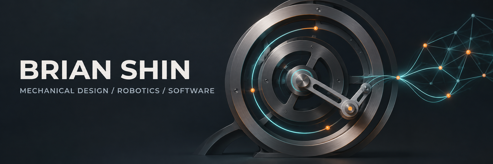

# Hi, I'm Brian 👋

기계 설계에서 로봇, 소프트웨어까지. 필요한 것을 직접 만드는 엔지니어입니다.

## 🛠️ Tech stack

**Hardware Design**

  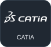
  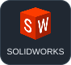
  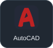
  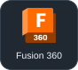
  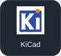

**CAE · Simulation**

  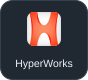
  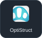
  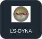
  
  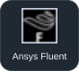
  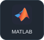
  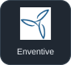

**Languages**

  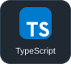
  
  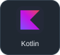
  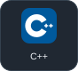
  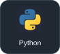

**Frontend · UI**

  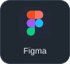
  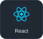
  
  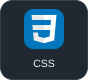
  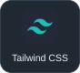
  

**Backend**

  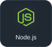
  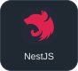

**Databases · ORM**

  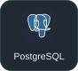
  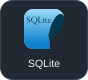
  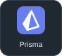

**Cloud · DevOps**

  
  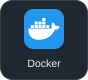
  
  

**Development environment**

  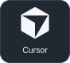
  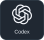
  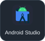
  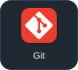

## 🔧 Things I've worked on

- **서비스 로봇 시스템** — 로봇·알림 장치·운영 소프트웨어의 기능 정의와 시제품 개발.
- **이동 로봇** — 리프팅 기구와 관제 구조 설계, 축소 로봇 제작.
- **전동 차량** — 차량 시스템·프레임·구동계 설계와 제작.
- **태양광 차량** — 카본 모노코크·공력 설계와 차량 패키징 총괄.
- **CAE 연구** — 복합소재·진동·조립 공차의 해석과 최적설계.

## 🔄 How I build

[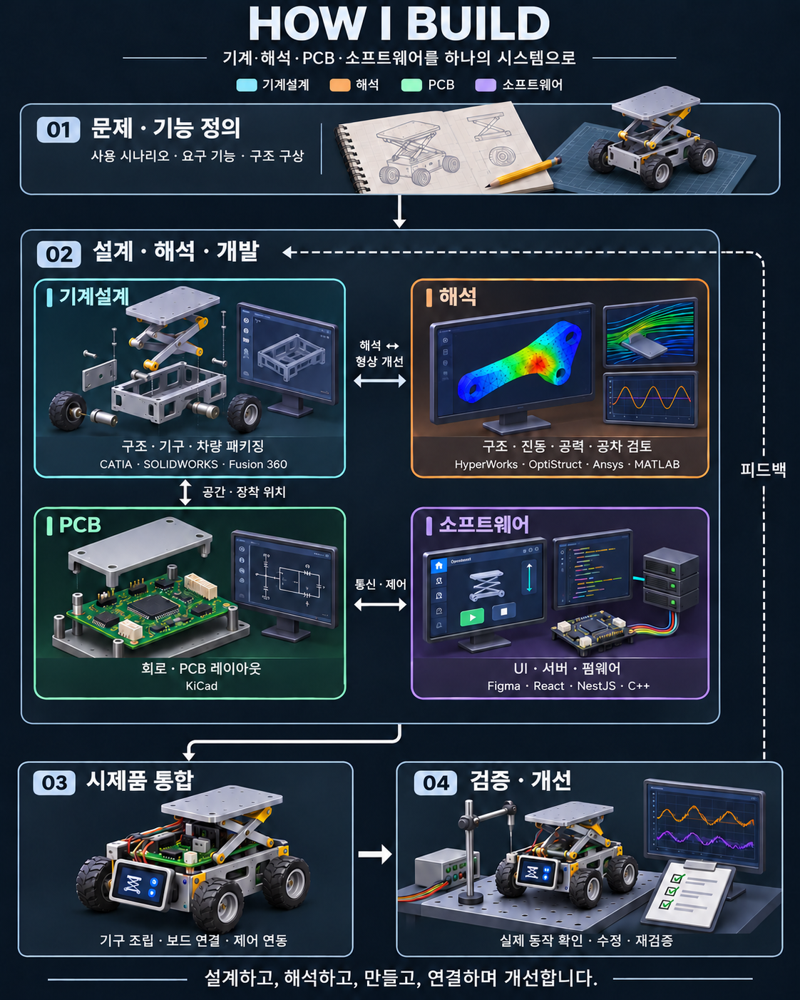](assets/workflow-isometric.png)

여러 프로젝트의 경험을 연결한 개념도입니다. 이미지를 누르면 크게 볼 수 있습니다.

## 🌱 Exploring

AI를 활용한 개발 · 엔지니어링 업무 자동화 · 개인 지식 시스템

---

차분하게, 꾸준히. 생각을 작동하는 것으로.

